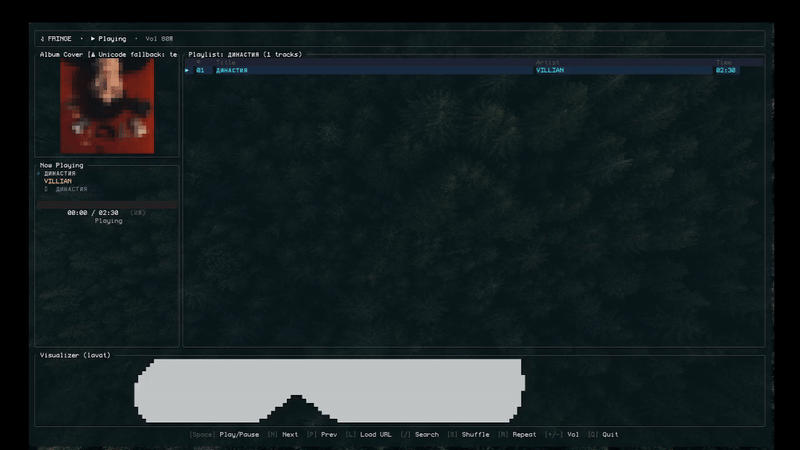

<div align="center">

# ♫ fringe

A fast, lightweight terminal music streamer with live synchronized lyrics and real-time visualizers.  
No Spotify Premium or desktop client required.

[](LICENSE)
[](https://www.rust-lang.org)

<br/>



</div>

---

## ⚡ Highlights

- **Word-Synced Karaoke Lyrics**: Words highlight in real-time as they are vocalized, with configurable effects (glow, adaptive underline, boxes, dots, or bold).
- **Embedded Visualizer via PTY**: Features a built-in CAVA audio spectrum equalizer, or lets you embed external terminal programs (`lavat`, system `cava`, `pipes.sh`) directly into the visualizer panel.
- **Terminal Album Art**: Native terminal graphics support (Kitty, iTerm2/WezTerm protocols) with clean high-res half-block Unicode fallback.
- **Zero-Lag Playback**: Smart local disk PCM caching and pre-buffering ensure immediate track start and fast playlist skipping.
- **AFK / Screensaver View**: Fullscreen mode for lyrics or spectrum visualizer.
- **Lightweight & Configurable**: Driven by a simple plain-text config at `~/.config/fringe/fringe.conf`.

---

## 🛠 Dependencies

Make sure you have `ffmpeg` and `yt-dlp` installed:

```bash
# Arch Linux
sudo pacman -S ffmpeg yt-dlp

# Debian / Ubuntu
sudo apt install ffmpeg yt-dlp

# Fedora
sudo dnf install ffmpeg yt-dlp
```

---

## 🚀 Installation

### Option 1: One-liner (Source)

```bash
git clone https://github.com/Beforov1337/fringe.git
cd fringe
./install.sh
```

The script builds the release binary and copies it to `~/.local/bin/fringe`.

### Option 2: Prebuilt Binary (GitHub Releases)

Download the latest binary for your architecture from [Releases](https://github.com/Beforov1337/fringe/releases):

```bash
tar -xzf fringe-linux-x86_64.tar.gz
chmod +x fringe
mv fringe ~/.local/bin/
```

### Option 3: Cargo Build

```bash
git clone https://github.com/Beforov1337/fringe.git
cd fringe
cargo build --release
./target/release/fringe
```

---

## ⌨ Controls

| Key | Action |
| :--- | :--- |
| `Space` | Play / Pause |
| `Enter` | Play selected track |
| `N` / `P` | Next / Previous track |
| `↑` / `↓` (`k` / `j`) | Navigate track list |
| `L` | Load Spotify playlist URL / presets |
| `/` | Live track search / filter |
| `S` | Toggle Shuffle |
| `R` | Toggle Repeat |
| `+` / `-` | Volume up / down |
| `Q` | Quit |

---

## ⚙ Configuration

Configuration file is located at `~/.config/fringe/fringe.conf` (created automatically on first launch):

```ini
# Theme: monochrome, synthwave, matrix, amber, custom
theme = monochrome

# Visualizer (CAVA or custom program)
# To embed an external program inside the visualizer panel (e.g. lavat):
# visualizer_cmd = lavat -c cyan -R 1
visualizer_cmd = 

bar_width = 2
bar_gap = 1
framerate = 60
sensitivity = 1.0
gravity = 28.0
noise_reduction = 0.77
monstercat = 1.0
show_peaks = false

# Lyrics active word effect: glow, underline, box, dots, bold
lyric_effect = glow
```

---

## 📄 License

This project is licensed under the **GNU General Public License v3.0 (GPL-3.0)**.  
See [LICENSE](LICENSE) for details. Proprietary closed-source resale is strictly prohibited.
